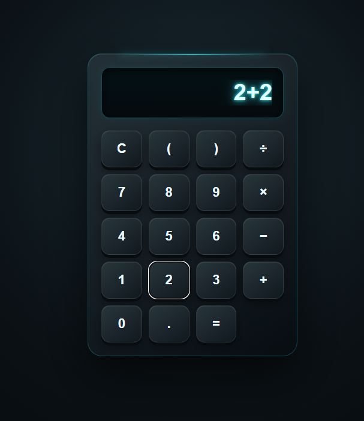

# Калькулятор

Простой калькулятор с веб-интерфейсом и отдельной реализацией на Python.

## ▶ Запустить калькулятор

**[Открыть веб-версию](https://ttmp-0.github.io/Calculator-python/)**

## Скриншот

## Возможны все функции простейшего калькулятора

- сложение
- вычитание
- умножение
- деление
- работа со скобками
- дробные числа
- очистка выражения
- обработка деления на ноль

### Команды и конструкции

Применялись базовые команды ввода, переменные, условные операторы:
- Python
- `input()`
- `if / elif / else`
- арифметические операции

## Python

В папке "python" отдельная реализация калькулятора на Python.

## О проекте

Проект создан как небольшой пример того, какие программы могут создавать ученики на языке программирования Python.

Веб-версия показывает готовый пользовательский интерфейс, а Python-версия демонстрирует ту же основную задачу с использованием базовых конструкций Python.
